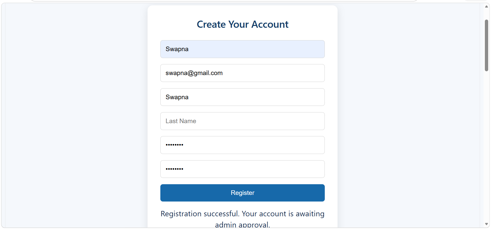
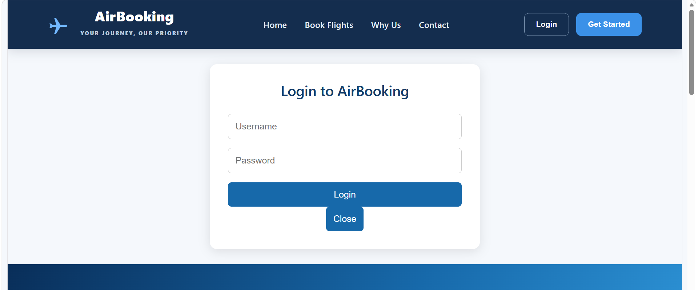
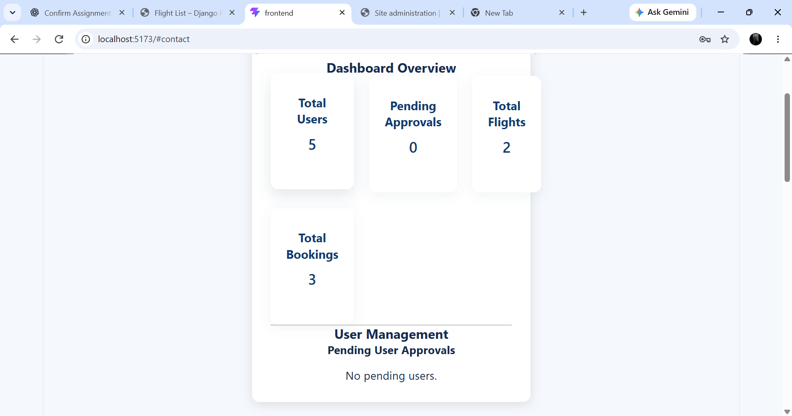
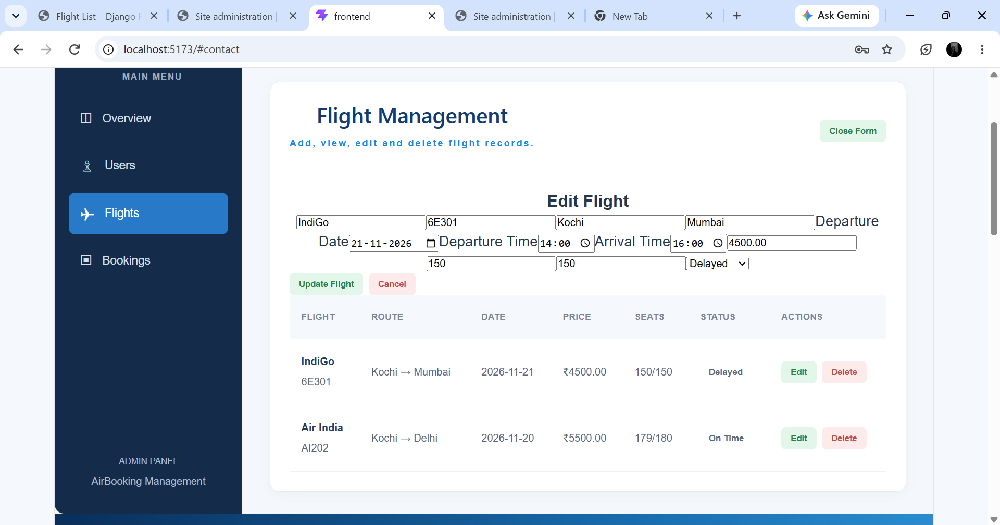
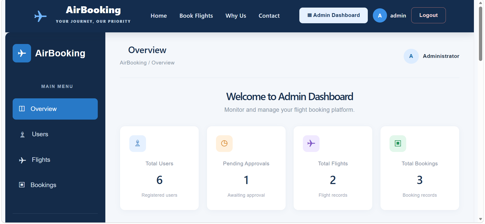
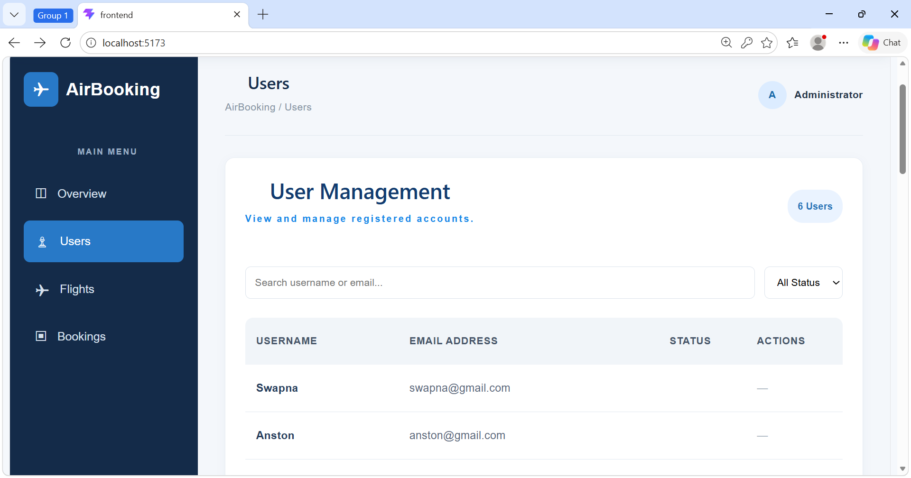
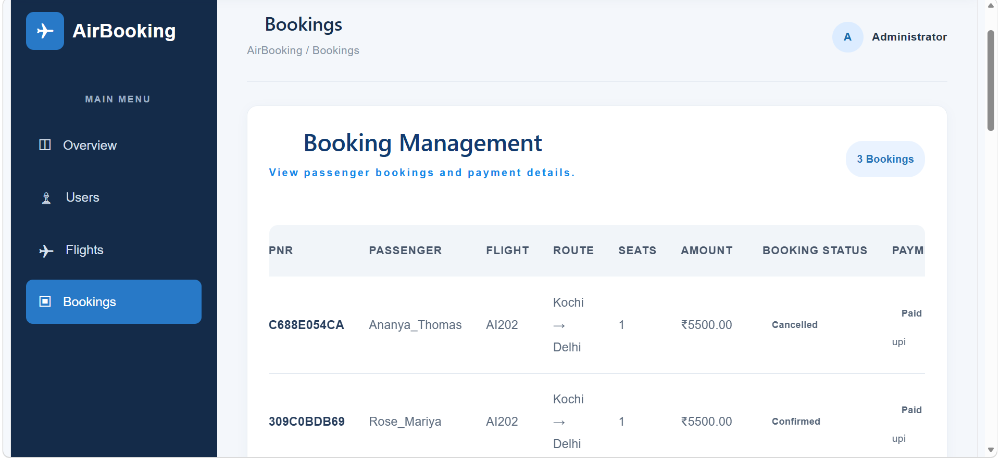

# ✈️ AirBooking – Flight Booking System

A full-stack Flight Booking System developed using **Django REST Framework (DRF)** and **React.js**. The application provides a platform where users can register, log in, search for available flights, book tickets, make payments and manage their trips. Administrators can manage user accounts, flights and bookings through a dedicated dashboard.

---

## 📌 Project Overview

AirBooking aims to simplify the flight booking process through an interactive web application with separate functionalities for users and administrators.

The system includes user registration with an approval workflow, JWT-based authentication, flight search, ticket booking and administrative management.

## 🚀 Features

### 1. User Features
- User registration and login.
- JWT-based authentication.
- User account approval workflow.
- Search and view available flights.
- View flight details, pricing and availability.
- Book flight tickets.
- Simulated payment process with available payment options.
- View personal bookings under My Bookings.

### 2. Admin Features
- Admin dashboard with booking statistics.
- View registered users.
- Approve or reject user registrations.
- Add, view, update and delete flights.
- View and manage customer bookings.

### 3. Additional Features
- Separate user and administrator functionalities.
- Protected API endpoints using JWT authentication.
- User approval and rejection workflow.
- Centralized flight and booking management.
- React-based frontend interface.

---

## 🛠️ Technologies Used

| Category | Technologies |
|---|---|
| Frontend | React.js, JavaScript, HTML5, CSS3 |
| Frontend Tool | Vite |
| Backend | Python, Django |
| API Framework | Django REST Framework |
| Authentication | Simple JWT |
| Database | SQLite |
| Development Environment | PyCharm |
| Version Control | Git and GitHub |

---

## 📂 Project Structure

```text
AirBooking/
│
├── backend/
│   ├── accounts/
│   ├── bookings/
│   ├── flights/
│   ├── config/
│   ├── manage.py
│   └── requirements.txt
│
├── frontend/
│   ├── src/
│   ├── public/
│   ├── package.json
│   └── index.html
│
├── screenshots/
│   ├── home.png
│   ├── registration.png
│   ├── login.png
│   ├── flight_search.png
│   ├── booking.png
│   ├── my_bookings.png
│   ├── admin_dashboard.png
│   ├── manage_users.png
│   ├── manage_flights.png
│   └── manage_bookings.png
│
└── README.md
```

---

## 📸 Application Screenshots

The following screenshots demonstrate the main functionalities of the AirBooking application.


### Home Page


### User Registration


### User Login


### My Trips


### Admin Dashboard


### Manage Users


### Manage Flights


### Manage Bookings

---

## ⚙️ Installation and Setup

### Prerequisites

Make sure the following software is installed:

- Python
- Node.js and npm
- Git

### Step 1: Clone the Repository

```bash
git clone https://github.com/rosemariyapc/AirBooking.git
cd AirBooking
```

### Step 2: Create and Activate Virtual Environment

```powershell
python -m venv venv
```

Activate the environment on Windows:

```powershell
.\venv\Scripts\Activate
```

### Step 3: Install Backend Dependencies

```powershell
cd backend
pip install -r requirements.txt
```

### Step 4: Configure Environment Variables

Create a `.env` file in the backend directory.

Add the Django secret key using the environment variable name configured in `settings.py`.

Example:

```env
DJANGO_SECRET_KEY=your_secret_key
```

Use your own secure secret key. Do not upload the `.env` file to GitHub.

### Step 5: Apply Database Migrations

```powershell
python manage.py migrate
```

### Step 6: Create Administrator Account

To create an administrator account, execute:

```powershell
python manage.py createsuperuser
```

Enter the required details when prompted:

- Username
- Email address
- Password
- Password confirmation

The created administrator account can be used to access the application's administrative functionalities.

**Note:** The administrator account is created locally by each user. No default admin password is published in this repository.

### Step 7: Start the Backend Server

```powershell
python manage.py runserver
```

Backend URL:

`http://127.0.0.1:8000/`

### Step 8: Install Frontend Dependencies

Open a separate terminal and navigate to the frontend directory:

```powershell
cd frontend
npm install
```

### Step 9: Start the Frontend Server

```powershell
npm run dev
```

Frontend URL:

`http://localhost:5173/`

The frontend and backend servers should both be running to use the application.

---

## 🔗 API Documentation

The application uses REST APIs to communicate between the React frontend and Django backend.

### Authentication APIs

| Method | Endpoint | Description |
|---|---|---|
| POST | `/api/auth/register/` | User registration |
| POST | `/api/auth/login/` | User login |

### Flight APIs

| Method | Endpoint | Description |
|---|---|---|
| GET | `/api/flights/search/` | Search available flights |
| GET | `/api/flights/admin/` | View flights for administration |
| POST | `/api/flights/admin/` | Add a flight |
| PUT/PATCH | `/api/flights/admin/{id}/` | Update flight details |
| DELETE | `/api/flights/admin/{id}/` | Delete a flight |

### Admin APIs

| Method | Endpoint | Description |
|---|---|---|
| GET | `/api/admin/dashboard/stats/` | View dashboard statistics |
| GET | `/api/admin/users/` | View registered users |
| POST | `/api/admin/users/{id}/approve/` | Approve a user |
| POST | `/api/admin/users/{id}/reject/` | Reject a user |
| GET | `/api/admin/bookings/` | View all bookings |

### Booking APIs

Booking operations are provided through the application's booking endpoints. Access requires the appropriate authentication and permissions.

**Note:** Protected endpoints require a valid JWT access token. The frontend handles authentication when communicating with the backend.

---

## 🔐 Security

- JWT-based authentication.
- Password management through Django authentication.
- Protected API endpoints.
- Role-based access for administrative operations.
- Environment variables for sensitive configuration.
- Database and environment files excluded from version control.

---

## 🧪 Application Testing

The application can be tested using the following workflow:

1. Start both backend and frontend servers.
2. Register a new user account.
3. Log in using an approved user account.
4. Search for available flights.
5. Select a flight and complete the booking process.
6. Check the booking under My Bookings.
7. Log in using the administrator account.
8. Review user registrations and approve or reject users.
9. Add, update or delete flight details.
10. View and manage customer bookings.

---

## 📁 Project Repository

GitHub Repository:

[https://github.com/rosemariyapc/AirBooking](https://github.com/rosemariyapc/AirBooking)

---

## 👩‍💻 Developed By

**Rose Mariya P C**

GitHub: [rosemariyapc](https://github.com/rosemariyapc)

---

*AirBooking – Making Flight Booking Simple and Convenient.*